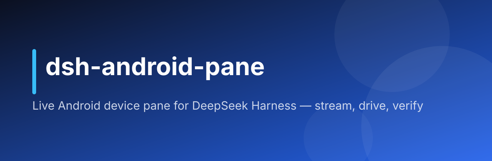
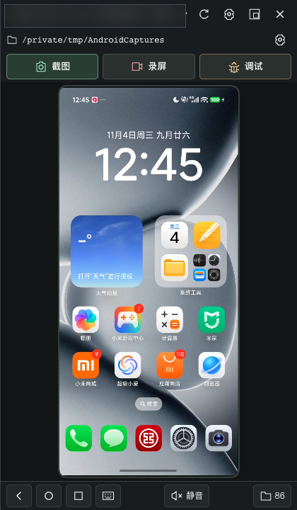
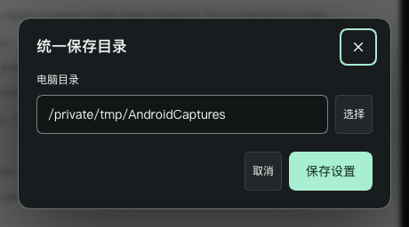
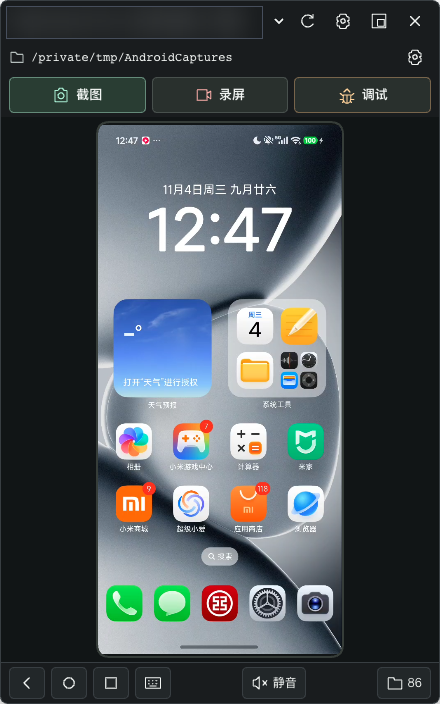
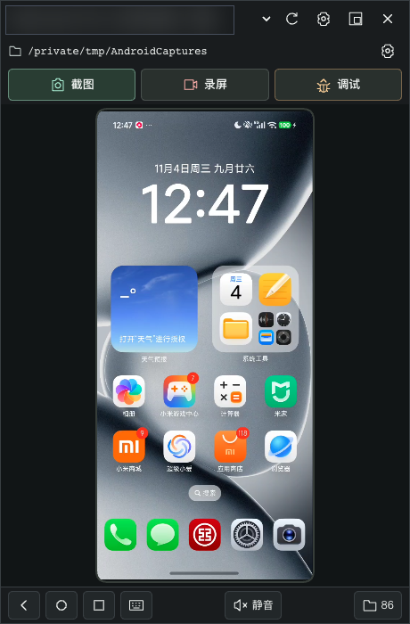
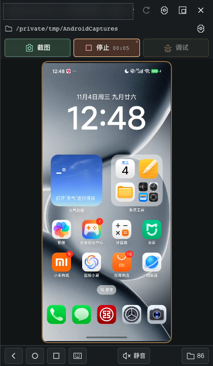
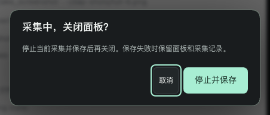

# dsh-android-pane



A **live Android device pane** next to your DeepSeek Harness (DSH) conversation: emulators and USB phones alike. The agent drives the device and proves its work with screenshots plus a structured UI tree; you can jump in at any time. Screenshots, recordings and debug evidence are saved straight into a host directory you pick.

[中文](README.md) · [Releases](https://github.com/hoyyang/dsh-android-pane/releases) · [Changelog](CHANGELOG.md)

<p align="center">
  <a href="LICENSE"></a>
  
  
</p>

## Install

```sh
dsh plugin add github:hoyyang/dsh-android-pane
```

Zero configuration: no API keys, no DSH config edits. Requires `adb` on PATH (Android SDK), a device with USB debugging (or any emulator); macOS/Linux and the DSH web profile. Debug analysis needs `ffmpeg` / `ffprobe` on the host. Linux directory picking uses Zenity or KDialog.

## Who it is for

- **Good fit**: you want the agent to actually tap an Android phone and return evidence; you want to watch the device inside DSH and take over; you need screenshots, recordings and debug logs archived in a fixed directory.
- **Good fit**: reproducing a reported tap path, accepting UI changes, recording the actions before a crash.
- **Not a fit**: static screenshots only; root-level injection or system modification (it never roots automatically); remote control outside the machine (loopback only).

## Features

- **A real right-hand column**: docked third in "conversation | right sidebar | Android pane | card detail", covering neither side; below 1000px it becomes a floating window.
- **Device picker**: the header lists online devices with model names and rebuilds the stream when you switch.
- **Full path bar**: the current save directory stays visible, wraps long paths, and its gear opens directory settings.
- **Bottom device keys**: back, home, recents, text input, mute and recent saves stay pinned below the picture.
- **Live stream**: scrcpy-server H.264 straight into the DSH web UI, decoded with WebCodecs; falls back to screenshot polling when scrcpy cannot run.
- **Real input in the pane**: press, drag and release on the H.264 picture are injected live; wheel input is normalized per pixel/line/page.
- **Keys and Chinese input**: back / home / recents / rotate / volume, plus clipboard-based Chinese text after a one-time ADBKeyboard setup.
- **Element-level actions**: `android_pane_ui` finds widgets by fuzzy text and taps their authoritative center instead of guessed coordinates.
- **Screenshots saved for real**: one click writes a PNG into the unified directory and reports the full path.
- **Recordings saved for real**: start, watch the timer, stop to save an MP4; the 180-second limit saves automatically while the device stays usable.
- **Debug sessions saved for real**: segmented MP4 + full logcat + action timeline, same prefix and directory.
- **Debug analysis**: per-action pre/post frames plus log slices, with frame times derived from the device clock and embedded recording timestamps; missing evidence is reported instead of invented.
- **One save directory**: Desktop bridge or host picker, draft-only selection, locked during capture, retry with another directory on failure.
- **Pending saves survive reloads**: recording and debug intents are persisted by the host and can still be saved afterwards.
- **Media mute and restore**: mute device media with one click and restore the previous volume.
- **Protected pages degrade honestly**: FLAG_SECURE is detected, the banner explains the limit, and a tappable element-tree view stays available; no automatic root.
- **Human/agent exclusion**: panel input is refused while an agent owns the device, with an explicit takeover; everything resumes after release and reconnect.
- **Disconnects never fake success**: capture and actions fail loudly while the device is gone and recover after reconnect.

## Quick start

1. Enable USB debugging and connect a phone (or start any emulator).
2. Click "Android pane" in the DSH session header.
3. The pane selects the online device and starts streaming.
4. Tap, drag and scroll directly on the picture.
5. Ask the agent to "connect my Android device" and it claims the device for input.
6. Click Screenshot and read the saved path shown below the picture.
7. Click Record, watch the in-place timer, click again to save an MP4.
8. Click Debug, perform a few actions, then stop to save video, log and timeline together.
9. Ask the agent to analyze and it receives per-action frames plus log slices.
10. Install the IME for Chinese input; click Mute for media silence.

## Use cases

- Reproduce a reported tap path and archive a screenshot per step.
- Accept UI changes on a real device and keep every screen.
- Record an intermittent problem, then stop and use the MP4.
- Capture the action sequence before a crash with debug mode and full logcat.
- Locate widgets and text through the element tree, then tap precisely.
- Verify Chinese input through ADBKeyboard and read the EditText back.
- Exercise FLAG_SECURE pages and confirm the banner and element-tree fallback.
- Compare devices through the same actions and save directory.
- Keep long tasks segmented: debug mode rotates every 170 seconds.
- Rehearse failure recovery with a read-only directory or an unplugged cable.

## Outputs

- A screenshot writes a 592×1280 PNG and reports the full path in the pane.
- A recording writes an MP4 and the timer stops in place.
- A debug session writes segmented MP4s (170s + tail), a full logcat file and an actions.json timeline.
- Analysis writes per-action pre/post PNG frames with uncertainty and calibration status.
- Failures write nothing into the registry and keep the pending save plus a retry path.

## Advanced

- **Chinese input**: `android_pane_install_ime` once, then send text from the pane.
- **Element actions**: `android_pane_ui` find/click/setText.
- **Secure-page switch**: config `flagSecureCheck` (default true).
- **Quality**: switch clear/fluid in settings; the stream reconnects with new bounds.
- **Reconnect**: use "Reconnect device" or reselect the device.
- **Dock/floating**: switch in settings; narrow windows float and return on restore.
- **Recent saves**: the bottom folder button previews images and videos.
- **Debug analysis**: stop a debug session, then analyze for frames and log slices.
- **Retry saving**: keep the pending record and retry with a writable directory.
- **Uninstall**: `dsh plugin remove dsh-android-pane`; state lives in `<DSH_HOME>/dsh-android-pane/`.

## Comparison

| Capability | dsh-android-pane 0.2.1 | scrcpy 5.x | scrcpy-mcp | mobile-mcp |
|---|---|---|---|---|
| Embedded DSH pane (dock/floating) | yes | no (own window) | no | no |
| H.264 live streaming | yes | yes | yes | yes |
| Real touch/wheel in the pane | yes | yes | no | no |
| Agent tools (tap/UI tree/Chinese input) | yes | no | yes | yes |
| Screenshot/recording saved to one directory | yes | manual commands | partial | partial |
| Debug session (segmented video + full logcat + timeline) | yes | no | no | partial (logs) |
| Protected-page detection and tree fallback | yes | no | no | no |
| Human/agent exclusion and takeover | yes | no | no | no |

Comparison rows follow the public README claims of each project; versions and implementations change, check their docs. Missing capabilities are written as "no".

## Reliability

- `npm test` covers capture regressions and 15 input groups; both pass.
- `npx tsc --noEmit` and `npm run build` pass; the plugin passes boot-check [A][B][D][E].
- Real-device runs cover streaming, tap/drag/wheel, long-press lease, mute restore and Chinese input.
- A 175-second debug session produced two segments (170.005s + 1.942s) with 81ms/258ms clock bounds and six calibrated frames.
- A 14-action session kept 24/24 frames calibrated even when the session clock was unavailable, and reported truncation and missing frames.
- Protected pages, disconnects, and uninstall/reinstall were verified end to end.
- Limits: Windows drive paths are source-level only (no Windows host here); sparse recordings may place frames seconds after an action, reported with frame times and uncertainty; log slices are not aligned when the session clock is unavailable, while frames stay calibrated per segment.
- Debug analysis requires ffmpeg/ffprobe on the host and names the missing binary instead of returning empty frames.

## FAQ

- **How do I let the agent drive an Android phone in DSH?** Install this plugin, let the agent call `android_pane_attach`, and it taps through the UI tools with a screenshot after each step.
- **Where do screenshots and recordings go?** Into the unified directory shown in the path bar; change it in settings.
- **What evidence does a debug session leave?** Segmented MP4, full logcat, an action timeline, and per-action frames plus log slices from analyze.
- **The picture is black, what now?** Usually FLAG_SECURE; the pane shows a banner and an element-tree fallback. For normal pages check `adb devices`.
- **Taps do nothing?** Some vendor builds require "USB debugging (Security settings)"; otherwise the pane stays view-only.
- **Does it need root?** No, and it never roots automatically; protected pages degrade within system limits.

## How it works

On attach, scrcpy-server is pushed to the device and runs H.264 encoding via app_process; the stream reaches the local loopback through adb port forwarding and is rendered with WebCodecs. Injection goes over adb; the element tree comes from uiautomator dump. Debug mode is host-managed: segmented recording, full logcat and a structured action timeline, with each frame mapped back to real time using the device clock and embedded timestamp metadata.

## Build locally

```sh
git clone https://github.com/hoyyang/dsh-android-pane && cd dsh-android-pane
npm install && npm run build
npm test
```

## Uninstall

```sh
dsh plugin remove dsh-android-pane
```

Uninstalling stops the stream and reaps adb children; state lives in `<DSH_HOME>/dsh-android-pane/`.

## Privacy

Screenshots of the device are sent to the configured model. Do not sign into real accounts on a controlled device.

## License

MIT — see [LICENSE](./LICENSE). Bundled `scrcpy-server` (Apache-2.0) and `ADBKeyboard.apk` (Apache-2.0) are listed in [THIRD_PARTY_NOTICES.md](./THIRD_PARTY_NOTICES.md).

## Screenshots












