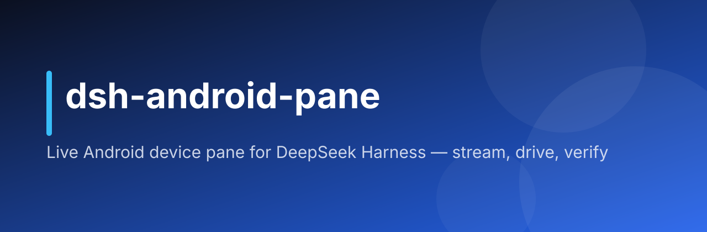
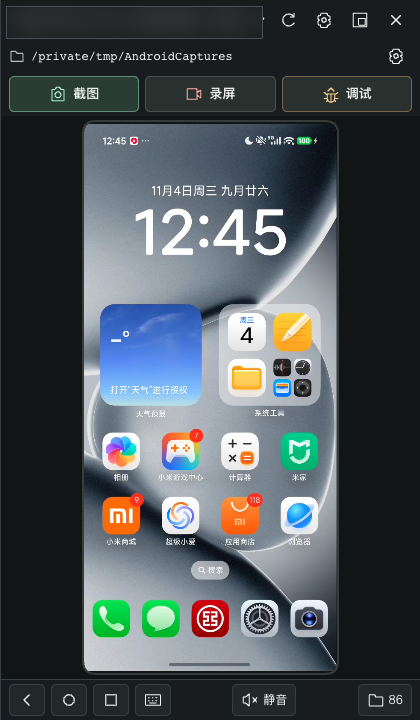
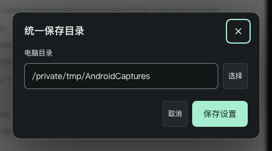
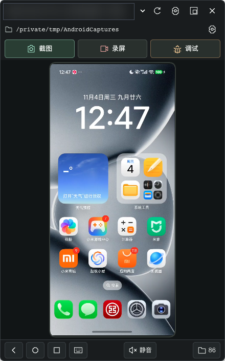
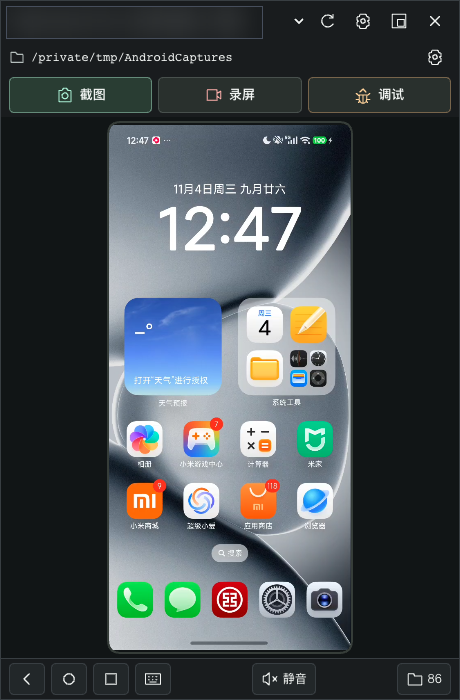
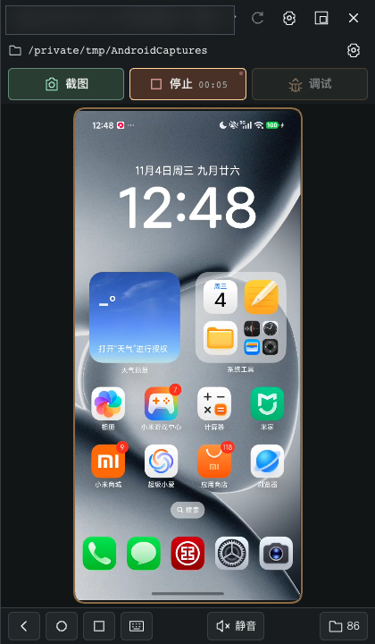
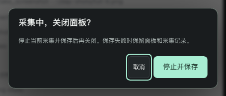

# dsh-android-pane



在 DeepSeek Harness（DSH）对话旁打开一块 **Android 实时画面面板**：模拟器和 USB 真机通吃，agent 能点按操作并用截图 + 控件树自证改动，你也能随时上手共操作；截图、录屏、调试证据直接存进你指定的电脑目录。

[English](README.en.md) · [Releases](https://github.com/hoyyang/dsh-android-pane/releases) · [更新日志](CHANGELOG.md)

<p align="center">
  <a href="LICENSE"></a>
  
  
</p>

## 安装

```sh
dsh plugin add github:hoyyang/dsh-android-pane
```

零配置：不需要 API Key、不需要改 DSH 配置。需要 `adb` 在 PATH（Android SDK），一台开了 USB 调试的设备或任一模拟器；macOS/Linux + DSH web profile。调试分析的抽帧需要宿主有 `ffmpeg` / `ffprobe`。Linux 的目录选择需要 Zenity 或 KDialog。

## 适合 / 不适合

- **适合**：你想让 agent 真的去点 Android 手机并给出证据；你要在 DSH 里随时看设备画面并接手操作；你需要把截图/录屏/调试日志留档到固定目录。
- **适合**：你要复现用户反馈的点击路径、验收 UI 改动、录制崩溃前的操作序列。
- **不适合**：只想看静态截图（用系统截屏更快）；需要 root 级注入或修改系统（本插件不自动 root）；需要跨网络远程控制（只允许本机回环访问）。

## 核心功能

- **一份真正的右侧列**：停靠形态排在「会话 ｜ 右侧边栏 ｜ Android 面板 ｜ 卡片详情」的第三格，不盖会话、不被详情盖；窄窗（<1000px）自动转浮窗。
- **设备选择下拉**：标题栏列出在线设备名称与型号，切换设备即重建串流。
- **完整路径条**：顶部常驻当前保存目录，长路径换行显示不省略，右侧齿轮直接打开目录设置。
- **底部设备键栏**：返回、主屏幕、最近任务、输入文字、静音与最近保存六个入口常驻，不随画面滚动。
- **实时画面**：scrcpy-server H.264 直推 DSH 网页端，WebCodecs 硬解；scrcpy 起不来时自动降级为截图轮播。
- **面板内真实输入**：H.264 画面上的按下、拖动、抬起直接注入设备，滚轮按像素/行/页归一；截图降级模式保留抬手后合成手势。
- **设备按键与中文输入**：返回 / 主屏 / 最近任务 / 旋转 / 音量键；一次性安装 ADBKeyboard 后中文经剪贴板输入。
- **元素级操作**：`android_pane_ui` 按文本模糊匹配控件，返回权威坐标后再点击，避免盲点打偏。
- **截图直接落盘**：一次点击保存 PNG 到统一目录，成功后显示完整路径，而不是另开图片标签。
- **普通录屏落盘**：开始计时、停止保存 MP4；180 秒到期自动保存，期间仍可截图与操作设备。
- **调试会话落盘**：分段 MP4 + 全量 logcat + 操作时间线，同一前缀、同一目录。
- **调试分析取证**：逐动作前后帧 + 日志切片，帧时刻来自设备时钟与录屏内嵌时间元数据；取不到就写明，不伪造前后对应。
- **统一保存目录**：Desktop 桥 / 宿主选择器选目录，选中只回填，保存设置生效；采集期间锁定，失败可换目录重试。
- **待保存可恢复**：录屏/调试的待保存意图写入宿主持久状态，进程重载后仍能继续保存。
- **媒体静音与恢复**：一键静音设备媒体，再点恢复原音量；不代表来电/闹钟静音。
- **受保护页面降级**：识别 FLAG_SECURE，横幅说明限制并提供可点按的控件树文本视图，不自动 root。
- **人机互斥**：设备被 agent 认领期间面板输入被拒绝，可显式接管；释放与重连后恢复。
- **断连不假装成功**：设备断开时采集与操作明确报错；重连后画面与主操作自动恢复。

## 30 秒快速上手

1. 手机开 USB 调试并连电脑（或启动任一模拟器）。
2. 在 DSH 会话头部点「Android 面板」。
3. 面板自动选中在线设备并开始串流；也可以在下拉里切换设备。
4. 直接在画面上点按、拖动、滚动——和真机操作一致。
5. 让 agent 说「连接我的安卓设备」，它会认领设备并接管输入。
6. 点「截图」，面板底部显示「已保存：/完整路径.png」。
7. 点「录屏」，按钮原位变「停止 00:05」；再点保存 MP4。
8. 点「调试」开始留证；做几步操作后再点停止，视频、日志、时间线一起落盘。
9. 想让 agent 取证据时调用 analyze，它会拿到每个动作的前后帧与日志切片。
10. 需要中文时先装输入法，再用文字入口发送；需要静音时点「静音」。
11. 点顶部路径条右侧的齿轮，打开统一保存目录设置。
12. 在设置里点「选择」挑一个可写目录，再点「保存设置」生效。
13. 点底部文件夹按钮查看最近保存，图片与视频可直接预览。
14. 设备被占用时点提示里的「接管」，或在面板外等待 agent 释放。
15. 在画面上长按图标并拖动，设备会跟随移动。
16. 点「重新连接设备」，断开的串流会自动恢复。
17. 打开受保护页面，观察横幅提示与「查看控件树」入口。
18. 在设置里切换画质清晰/流畅，确认画面尺寸随之变化。

## 使用场景

- **复现用户反馈**：按反馈路径在面板里点一遍，每步截图留档，交给 agent 对照日志分析。
- **验收 UI 改动**：改完直接看真机效果，逐屏截图存进统一目录。
- **录制偶现问题**：开始普通录屏，等复现后停止，MP4 直接可用。
- **崩溃前操作序列**：调试模式录屏 + 全量 logcat，事后按动作时间线回放。
- **定位控件与文案**：用控件树找到元素中心坐标，再让 agent 精确点击。
- **中文输入链路验证**：通过 ADBKeyboard 输入中文并回读 EditText。
- **受保护页面演练**：银行/密码类应用打开时观察横幅与控件树降级是否符合预期。
- **多设备对比**：切换设备复用同一套操作与保存目录。
- **长时间任务留证**：调试会话按 170 秒分段轮转，长任务不丢证据。
- **失败恢复演练**：把目录改成只读或断开数据线，验证失败提示、待保存与重试。
- **对比改动前后**：同一路径连续截图两次，肉眼比对改版差异。
- **交接给同事**：把统一目录里的 PNG/MP4/日志打包，别人无需复跑就能看懂操作序列。
- **长期回归**：每次发版跑一遍 npm test，并用真机点几条主路径。

## 运行结果

- 截图实测产出一张 592×1280 的 PNG（约 165 KB），面板提示「已保存：完整路径.png」。
- 普通录屏实测 38.3 秒产出 81 KB 的 MP4，ffprobe 显示 H.264 592×1280。
- 调试会话实测产出两段视频：170.005 秒与 1.942 秒，同前缀命名。
- 调试日志实测落地 123 行切片，完整未过滤日志另存为 logcat.log。
- 调试分析为每个动作产出前后帧 PNG：6 个动作得到 6 张，帧时刻不确定度 41–129 毫秒。
- 175 秒会话实测：分段时钟宽度 81 毫秒与 258 毫秒，6 帧全部校准、无顺序违规。
- 失败时输出明确错误：受保护页面返回「受保护页面不可截图」，记录数不变。
- 断连实测：冻结 adb 后截图报错且不登记；恢复后截图成功，产物写入统一目录。
- 媒体静音实测：面板显示静音后设备媒体音量为 0，再点一次恢复原值。
- 目录切换实测：把统一目录指到 /private/tmp/AndroidCaptures 后，新截图实际写入该目录。
- 动作截断实测：14 个动作只分析最近 12 个，frameIssues 写明「更早的 2 个未取前后帧」。

## 输入输出对照

| 输入 | 输出 |
|---|---|
| 点「截图」 | 统一目录下的 PNG 与完整路径提示 |
| 「录屏」开始 → 停止 | MP4（180 秒到期自动保存） |
| 「调试」开始 → 操作 → 停止 | 分段 MP4 + logcat + actions.json |
| 调用 analyze | frames/ 前后帧 PNG + 日志切片文本 |
| `android_pane_ui find` | 控件节点列表与中心坐标 |
| `android_pane_ui click` | 点击执行结果与截图路径 |
| 面板输入中文 | 设备 EditText 实际内容与截图 |
| 设备断开后再操作 | 明确错误信息，不产生成功记录 |

## 输入输出示例

```sh
$ node scripts/check-capture.mjs
PASS: persistent record/debug/volume recovery; state atomic upgrade, ... device-clock calibrated sparse-frame selection and fresh-frame acceptance
```

```sh
$ node scripts/check-input.mjs
PASS 15 input check groups (protocol, validation, lease, hub, coordinates/UI, queue, capture; no device/spawn)
```

```sh
$ curl -s http://127.0.0.1:3080/_dsh/dsh-android-pane/devices
{"ok":true,"devices":[{"serial":"<serial>","state":"device","model":"<model>","name":"<device>"}],"quality":{"maxSize":1280,"maxFps":30,"videoBitRate":8000000}}
```

```sh
$ curl -s http://127.0.0.1:3080/_dsh/dsh-android-pane/capture
{"ok":true,"directory":"/private/tmp/AndroidCaptures","record":null,"debug":null,"outputs":[...]}
```

```sh
$ adb devices
List of devices attached
<serial>	device
```

```sh
$ ffprobe -v error -show_entries format=duration -of csv=p=0 dbg-...-seg-000.mp4
170.004822
```

```sh
$ node -e "console.log(require('./package.json').version)"
0.2.0
```

```sh
$ npx tsc --noEmit -p . && echo typecheck-ok
typecheck-ok
```

## 进阶用法

- **中文输入**：`android_pane_install_ime` 一次性安装 ADBKeyboard，之后用文字入口发送中文。
- **元素级操作**：`android_pane_ui` 的 find/click/setText，按文本模糊匹配，替代盲点坐标。
- **安全页面检测开关**：config `flagSecureCheck`（默认 true）。
- **画质设置**：面板设置里切清晰/流畅，改变最大边与码率，重连后生效。
- **串流恢复**：串流卡住时点「重新连接设备」，或在设备菜单重选设备。
- **浮窗与停靠**：面板设置里切换形态；窄窗自动浮窗，恢复后回到右侧列。
- **最近保存**：底部文件夹按钮打开记录，可预览图片与视频。
- **调试分析**：停止调试后调用 analyze，拿逐动作前后帧与日志切片。
- **保存失败重试**：停止失败时面板保留待保存记录，换一个可写目录再点重试。
- **卸载**：`dsh plugin remove dsh-android-pane`，状态在 `<DSH_HOME>/dsh-android-pane/`，可整目录删除。

## 与同类对比

| 能力 | dsh-android-pane 0.2.1 | scrcpy 5.x | scrcpy-mcp | mobile-mcp |
|---|---|---|---|---|
| DSH 内嵌面板（右侧列/浮窗） | 有 | 无（独立窗口） | 无 | 无 |
| H.264 实时串流 | 有 | 有 | 有 | 有 |
| 面板内真实触摸/滚轮 | 有 | 有 | 无 | 无 |
| agent 工具（点按/控件树/中文输入） | 有 | 无 | 有 | 有 |
| 截图/录屏直接落盘到统一目录 | 有 | 需自己拼命令 | 部分 | 部分 |
| 调试会话（分段录屏 + 全量 logcat + 时间线） | 有 | 无 | 无 | 部分（日志） |
| 受保护页面识别与控件树降级 | 有 | 无 | 无 | 无 |
| 人机互斥与接管 | 有 | 无 | 无 | 无 |

对比对象取自各项目公开 README 的能力声明；版本与实现会变，以各自文档为准。我方没有的能力照实写「无」。

## 可靠性与验收

- `npm test`：采集回归（状态原子升级、固定目录、FLAG_SECURE 守卫、保存重试与分段轮转、登记与预览、旧实例竞态、时钟宽度边界、稀疏帧选择与新鲜帧校验）+ 15 组输入回归，全部通过。
- `npx tsc --noEmit` 与 `npm run build` 通过；`boot-check.sh` 中本插件 [A][B][D][E] 项全 PASS。
- 真机实测（多品牌 USB 真机与模拟器）：H.264 串流、点按/拖动/滚轮、长按续租、媒体静音恢复、中文输入回读。
- 175 秒调试会话实测：两段 170.005s + 1.942s，分段时钟 81ms / 258ms，6 帧全部校准、前后帧顺序无违规。
- 14 动作会话实测：会话时钟缺失时 24/24 帧仍按分段时钟校准，动作截断与无新帧都有明确提示。
- 受保护页面实测：识别 FLAG_SECURE，截图调用被明确拒绝，调试前弹「可能黑屏」确认。
- 断连实测：冻结 adb 服务后截图报错且不登记，恢复后画面与截图自动恢复。
- 卸载重装实测：卸载后面板与边距全清、路由 404；装回后单实例、串流与截图恢复。
- 限制：Windows 盘符路径只做源码级验证（本机无 Windows）；静态画面下录屏帧稀疏，前后帧可能晚于操作数秒，帧时刻与不确定度会如实标注；会话时钟不可用时日志切片不对齐，帧仍按分段时钟校准。
- 调试分析的抽帧依赖宿主的 ffmpeg/ffprobe，缺失时会直接点名缺哪个，不会静默返回空帧。

## 常见问题

- **DSH 里怎么让 agent 操作安卓手机？** 装本插件，让 agent 调 `android_pane_attach` 认领设备，然后它用点按/控件树/输入工具操作，每步自动回截图。
- **怎么把截图/录屏保存到电脑？** 点面板上的「截图」「录屏」，产物落到统一目录；路径条随时可见，设置里可换目录。
- **调试能留下什么证据？** 分段 MP4、全量 logcat、操作时间线，外加 analyze 生成的逐动作前后帧与日志切片。
- **画面全黑怎么办？** 多半是 FLAG_SECURE 页面，面板会出横幅并给出可点按的控件树；普通页面黑屏先确认 `adb devices` 在线。
- **点按没反应？** 部分厂商深度定制系统需要打开「USB 调试（安全设置）」，否则面板会降为只看。
- **需要 root 吗？** 不需要，插件也不会自动 root；受保护页面在无 root 时按系统限制降级。

## 工作原理

attach 时把 scrcpy-server 推上设备、以 app_process 跑 H.264 编码，视频流经 adb 端口转发到本机回环，网页端用 WebCodecs 硬解渲染；注入指令经 adb 下发，控件树来自 uiautomator dump。调试模式由 host 托管：分段录屏 + 全量 logcat + 结构化动作时间线，并在分析时按设备时钟与录屏内嵌帧时间把每一帧映射回真实时刻。

## 本地构建

```sh
git clone https://github.com/hoyyang/dsh-android-pane && cd dsh-android-pane
npm install && npm run build
npm test
```

## 卸载

```sh
dsh plugin remove dsh-android-pane
```

卸载即停流、回收 adb 子进程；状态在 `<DSH_HOME>/dsh-android-pane/`，可整目录删除。

## 隐私

agent 对设备的截屏会发送给所配置的模型。勿在受控设备上登录真实账号。

## 许可证

MIT — 见 [LICENSE](./LICENSE)。随包分发的 `scrcpy-server`（Apache-2.0）与 `ADBKeyboard.apk`（Apache-2.0）见 [THIRD_PARTY_NOTICES.md](./THIRD_PARTY_NOTICES.md)。

## 截图











